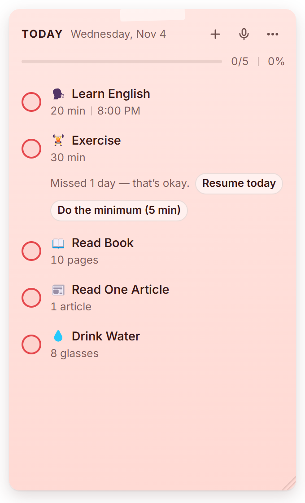
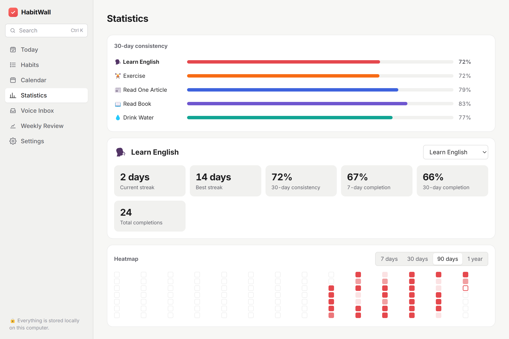
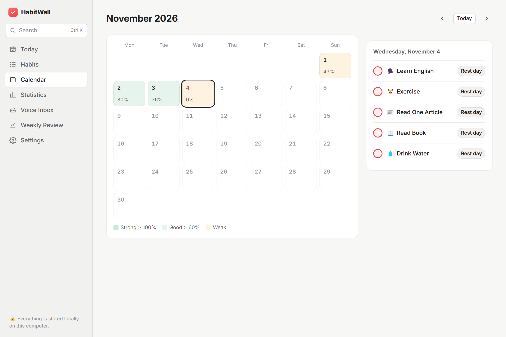
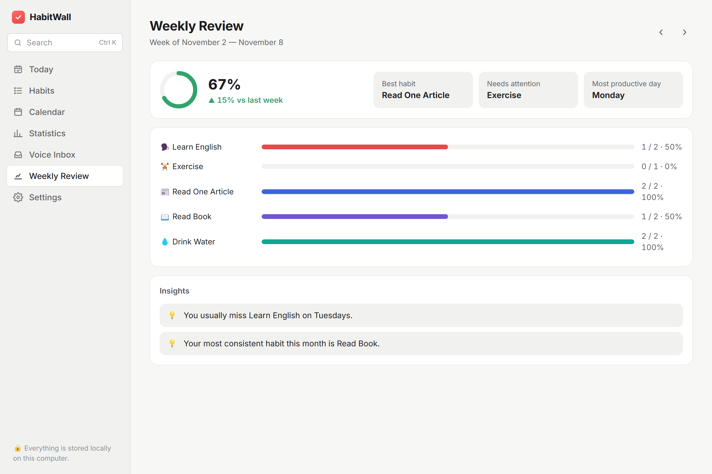

# HabitWall

**Habits as a sticky note on your Windows desktop. Logging a day takes one click.**

A local-first desktop habit tracker built with **Tauri 2 (Rust)**, **React 19**, **TypeScript** and **SQLite**. It has a frameless sticky-note widget for daily use and a full dashboard for statistics, calendar and weekly reviews.

<p>
  
  
</p>

## Features

- **Sticky widget:** frameless, draggable and resizable. It can stay always on top, act as a normal window, or pin to the desktop. It lives in the system tray and can start with Windows.
- **Today:** a "Big 3" focus list, one-click complete, +5/+10 quick amounts, a timer for minute-based habits, a right-click menu (partial, skip, rest day, note, snooze, edit), and Undo instead of confirmation prompts.
- **Streaks without punishment:** current streak, 30-day consistency, best streak, and 7/30-day completion. A "minimum version" keeps a streak alive, and Recovery Mode offers *Resume today* or *Do the minimum*.
- **Voice and natural language:** create habits, log check-ins, and capture ideas to the Voice Inbox, e.g. *"I want to study English every day at 8 pm for twenty minutes"* or *"Today I exercised for half an hour"*. An on-device parser always runs; AI refinement is optional, and the API key stays in the Windows Credential Manager.
- **Dashboard:** Today, Habits, Calendar, Statistics with heatmaps, Voice Inbox, Weekly Review with insights, Settings, and global search (Ctrl+K).
- **Six themes** for the sticky note, plus light and dark mode for the dashboard.
- **Local-first:** SQLite on this computer, no account.

| Calendar | Weekly review |
|---|---|
|  |  |

## Shortcuts

| | |
|---|---|
| Ctrl+Shift+H | Show / hide the widget |
| Ctrl+Shift+V | Voice capture |
| Ctrl+Shift+N | New habit |
| Ctrl+Z | Undo the last action |
| Ctrl+K | Search (dashboard) |

All three global shortcuts can be changed in Settings.

## Tech stack

| | |
|---|---|
| Desktop shell | Tauri 2 (Rust): tray, global shortcuts, autostart, notifications, single instance |
| Frontend | React 19, TypeScript, Vite, Zustand |
| Storage | SQLite through a small Rust bridge (`rusqlite`, WAL, atomic multi-statement batches) |
| Secrets | API keys in the OS credential store (`keyring`); network calls happen in Rust only |
| Tests | Vitest: domain logic, voice parser, and the repository against SQLite (sql.js) |

## Develop

Requirements: Node 22, Rust (stable, MSVC), Visual Studio Build Tools (C++), WebView2 (included with Windows 11).

```bash
npm install
npm run app:dev      # desktop app with hot reload
npm test             # unit tests (domain logic + repository against SQLite)
npm run app:build    # installer → %LOCALAPPDATA%\habitwall-target\release\bundle\nsis\
```

`npm run dev` serves the same UI in a browser with an in-memory SQLite (sql.js), saved to localStorage. It is for UI work only; the screenshots above were taken this way.

## Layout

```
src/core      pure domain logic (dates, schedules, status, stats, review, insights, reminders, voice parser), unit tested
src/data      SQLite schema/migrations, repository, demo data
src/services  day clock (rollover), reminders, voice pipeline, AI prompt/schema
src/state     zustand store, actions (write → sync → undo), selectors
src/widget    sticky widget, habit row, onboarding
src/dashboard dashboard screens and the habit editor
src/i18n      UI strings and date formatting
src-tauri     Rust: SQLite bridge, keychain, transcription/AI HTTP, tray, windows
docs/DESIGN.md architecture, schema, screen map, flows
```

See [docs/DESIGN.md](docs/DESIGN.md) for the architecture, database schema, time model (logical days and rollover) and the voice pipeline.

## License

[MIT](LICENSE). The bundled Inter font is licensed under the SIL Open Font License.
